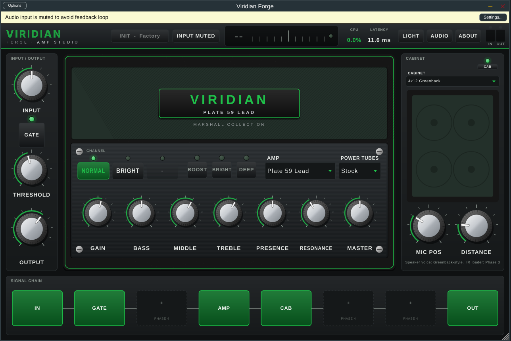

<p align="center"></p>

# Viridian Forge

**Guitar amp and effects modeling — standalone app and VST3/AU plugin for Windows, macOS and Linux.**
By Viridian Audio Works.



> **Status: Phase 2 of 7.** The app, plugin, interface, branding, the circuit-based amp
> engine with its first 10 amp models, and the cabinet simulator are built. NAM, IR loading,
> the rest of the 100+ amp catalog, the effects library and presets are planned for later
> phases and are not implemented yet. See [docs/ARCHITECTURE.md](docs/ARCHITECTURE.md).

## What works today

- Standalone app (with audio device settings) and VST3 plugin; AU on macOS.
- **Circuit-based amp engine:** 12AX7 preamp stages solved on their load lines from a published
  tube model, grid conduction with coupling-cap bias shift (touch-sensitive compression and
  recovery), tone stacks computed from component values, push-pull power stage with 7 tube types,
  negative feedback, rectifier sag, and a solid-state mode. 4x oversampled.
- **10 amp models / 14 channels**, level-matched and switchable without clicks:

  | Model | Category | Channels | Inspired by |
  |---|---|---|---|
  | Canyon 6V6 Clean | American Clean | 1 | '65 blackface Deluxe Reverb |
  | Canyon 100 Clean | American Clean | 1 | '65 blackface Twin Reverb |
  | Tweed Forge 59 | Vintage | 1 | '59 tweed Bassman |
  | Glass Clean 120 | Vintage | 1 | 1970s solid-state stereo jazz combos |
  | Mayfair 30 TB | British Clean | 2 | Vox AC30 Top Boost |
  | Plate 59 Lead | Marshall Collection | 2 | Marshall 1959 Super Lead |
  | Forge 82 Lead | Classic Rock | 1 | Marshall JCM800 2203 |
  | Velvet OD | Boutique | 2 | Dumble Overdrive Special |
  | Ridgeline Classic | Boutique | 2 | Two-Rock Classic Reverb |
  | Junkyard 30 | Boutique | 1 | Dr. Z Z-Wreck |

  Product names are trademarks of their owners and are used only to describe the tones that
  guided these original models; no affiliation or endorsement is implied.
- Power-tube swap on any model (EL34, 6L6, EL84, 6550, KT88, 6V6, 5881), gain, bass, middle,
  treble, presence, resonance, master, bright, deep, boost, noise gate.
- **Cabinet simulator:** 7 cabinets (1x12 open, 2x12 alnico, 4x10 tweed, 4x12 Greenback-style,
  4x12 V30-style, 4x12 modern, 1x12 closed) with mic position and distance.
- Chromatic tuner, input/output meters with clip LEDs, CPU and latency readouts.
- Resizable UI with dark and light themes, splash and About screens.
- Full session save/restore and automation of every parameter.
- 736 automated DSP checks (every model and cabinet included), run on all three OSes by CI.

## Build

Requirements on every OS: **CMake 3.22+**, **Git**, and a C++17 compiler. The first configure
downloads JUCE 8.0.4 automatically (or point to your own copy with `-DJUCE_DIR=/path/to/JUCE`).

### macOS (Xcode command-line tools)

```bash
xcode-select --install          # once
git clone https://github.com/vfxchris581/new-app.git && cd new-app
cmake -S . -B build -G Xcode    # or -G Ninja
cmake --build build --config Release
ctest --test-dir build -C Release
```

Results in `build/app/ViridianForge_artefacts/Release/`:
- `Standalone/Viridian Forge.app` → run it directly, or copy to `/Applications`
- `VST3/Viridian Forge.vst3` → copy to `~/Library/Audio/Plug-Ins/VST3/`
- `AU/Viridian Forge.component` → copy to `~/Library/Audio/Plug-Ins/Components/`

Builds are universal (Apple Silicon + Intel). Local builds are unsigned: if macOS blocks the app,
right-click it and choose **Open** once.

### Windows (Visual Studio 2022, "Desktop development with C++")

```powershell
git clone https://github.com/vfxchris581/new-app.git
cd new-app
cmake -S . -B build -G "Visual Studio 17 2022" -A x64
cmake --build build --config Release
ctest --test-dir build -C Release
```

Results in `build\app\ViridianForge_artefacts\Release\`:
- `Standalone\Viridian Forge.exe`
- `VST3\Viridian Forge.vst3` → copy to `C:\Program Files\Common Files\VST3\`

For lowest standalone latency on Windows, use your interface's ASIO driver (building JUCE with
ASIO support requires the Steinberg ASIO SDK; WASAPI exclusive mode works without it).

### Linux (Ubuntu/Debian)

```bash
sudo apt install build-essential cmake ninja-build git libasound2-dev libjack-jackd2-dev \
  libfreetype-dev libfontconfig1-dev libx11-dev libxcomposite-dev libxcursor-dev libxext-dev \
  libxinerama-dev libxrandr-dev libxrender-dev libgl1-mesa-dev
git clone https://github.com/vfxchris581/new-app.git && cd new-app
cmake -S . -B build -G Ninja -DCMAKE_BUILD_TYPE=Release
cmake --build build
ctest --test-dir build
```

Results in `build/app/ViridianForge_artefacts/Release/`:
- `Standalone/Viridian Forge` → run it
- `VST3/Viridian Forge.vst3` → copy to `~/.vst3/`

## Running the standalone app

1. Use headphones. Plug your guitar into input 1 of your audio interface.
2. Click **AUDIO** to choose the interface, sample rate (48 kHz is a good default) and a buffer of
   64–256 samples.
3. Click **INPUT MUTED** to switch to **LIVE INPUT** (input starts muted to prevent speaker feedback).
4. Tune with the tuner in the top bar, then play.

Building only the DSP core and tests (no JUCE download): `cmake -S . -B build -DVF_BUILD_PLUGIN=OFF`.

## Project layout

| Path | Contents |
|---|---|
| `core/` | JUCE-free DSP core (amp voice, tone stack, tubes, gate, tuner, parameters) |
| `app/` | JUCE processor, editor and UI components |
| `tests/` | Core unit tests (CTest) |
| `resources/branding/` | Icon (SVG + PNG), wordmark, reference guitar photo |
| `scripts/make_branding.py` | Regenerates the icon and wordmark |
| `docs/` | Architecture & roadmap, testing checklist |

## Licensing note

No license has been chosen yet. JUCE 8 is available under AGPLv3 or a commercial licence, so the
license for this project depends on how you plan to release it (see
[docs/ARCHITECTURE.md §6](docs/ARCHITECTURE.md#6-licensing-and-compatibility-limitations)).

Amp, pedal, speaker and microphone names mentioned in the docs are trademarks of their owners and
are used only to describe the tones that inspired original models. No affiliation or endorsement
is implied. VST is a registered trademark of Steinberg Media Technologies GmbH.
