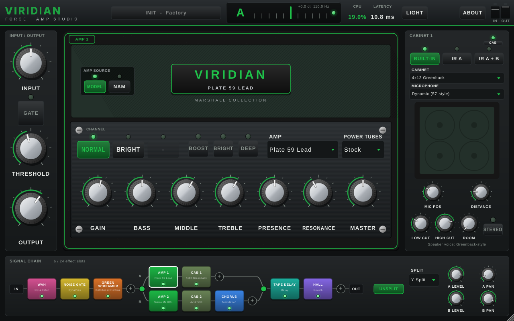
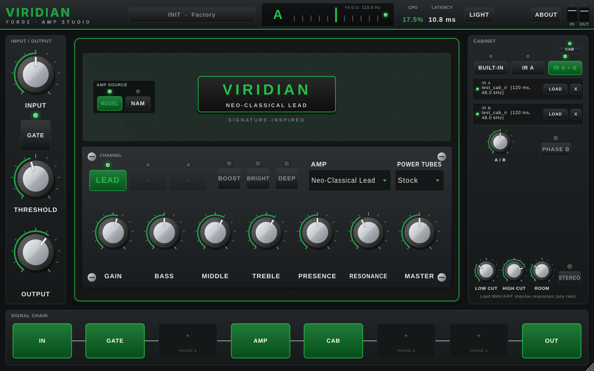
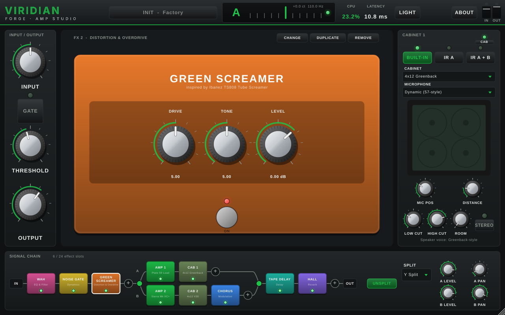

<p align="center"></p>

# Viridian Forge

**Guitar amp and effects modeling — standalone app and VST3/AU plugin for Windows, macOS and Linux.**
By Viridian Audio Works.



> **Status: Phase 4 of 7.** The app, plugin, interface, circuit-based amp engine with
> **104 amp models**, Neural Amp Modeler support, impulse-response loading, the cabinet section,
> **107 effects** and the **drag-and-drop signal chain** with parallel lanes are built. The preset
> system (Phase 5) is not implemented yet. See [docs/ARCHITECTURE.md](docs/ARCHITECTURE.md).

## What works today

- Standalone app (with audio device settings) and VST3 plugin; AU on macOS.
- **Circuit-based amp engine:** 12AX7 preamp stages solved on their load lines from a published
  tube model, grid conduction with coupling-cap bias shift (touch-sensitive compression and
  recovery), tone stacks computed from component values (including separate clean-channel EQs),
  push-pull power stage with 7 tube types, negative feedback, rectifier sag, a solid-state mode,
  and a Mesa-style post-gain 5-band graphic EQ. 4x oversampled.
- **104 amp models / 187 channels** across all 12 categories, level-matched and switchable
  without clicks — including the full **Mesa Mark collection** (Mark I, IIA, IIB, IIC, IIC+, III,
  IV, V, VII) with graphic EQ, the **Rectifier family** (Dual, Triple, Single, Road King,
  Roadster), the **Marshall collection** (JTM45 through JVM, 1970s variants, modded Marshalls)
  and a neo-classical shred lead model. Full list: [docs/AMP_CATALOG.md](docs/AMP_CATALOG.md).
  Product names are trademarks of their owners and only describe the tones that guided these
  original models; no affiliation or endorsement is implied.
- **Neural Amp Modeler:** load any mono `.nam` capture (WaveNet, LSTM, ConvNet, A2 and more via the
  official NeuralAmpModelerCore v0.6.0). Background loading, click-free swapping, automatic
  resampling when your session runs at a different rate than the capture, loudness normalisation,
  and a capture library (import/browse). The amp knobs keep working: Gain drives the capture,
  the EQ knobs shape it, Master sets its level.

  
- **Cab Lab (cabinets and mics):** **35 cabinets**. That is 20 4x12s and 12 2x12s, heavy on
  high-gain metal cabs (Rectifier-, 5150-, 6505-, Diezel-, ENGL-, Krank- and Uberkab-style), plus
  1x12s and a 4x10. Some cabs have mixed speakers.
  - **Two mics you place with the mouse:** on any speaker, from the dust cap to the cone edge, in
    front of the cab or behind it, 0–30 cm away and up to 60° off-axis.
  - **10 mic types**, each with level control; mic B adds a phase flip. Time Align fixes two-mic
    comb filtering, and a live frequency-response curve shows the result.
  - **Room mics in 18 environments:** studios in five sizes, rooms, chambers and outdoor spaces.
    Room distance is adjustable. Full list: [docs/CAB_CATALOG.md](docs/CAB_CATALOG.md).
  - Or load **WAV/AIFF impulse responses** into slots A and B, with blend, phase invert and true
    stereo. Low cut and high cut work in both modes.

  

  
- **107 effects** in 9 categories, all original DSP: 26 drives/fuzzes/boosts (2x oversampled),
  19 modulation (chorus, flangers, phasers, Uni-Vibe, tremolos, rotary, ring mod...), 17 delays
  (analog, tape, multi-head, ping-pong, reverse, shimmer, granular, looper...), 12 reverbs
  (FDN halls/rooms/plates, spring, gated, reverse, shimmer...), 9 dynamics, 10 EQ/filters
  (wah, auto-wah, envelope, talk box, step filter...), 4 pitch, 7 creative (synth, glitch, freeze,
  bit crusher...) and 3 utilities. Full list with controls: [docs/EFFECTS_CATALOG.md](docs/EFFECTS_CATALOG.md).

  
- **Signal chain / pedalboard:** up to 24 effects plus **Amp 1, Amp 2, Cab 1 and Cab 2** in any
  order. Drag blocks to reorder, **+** to add, double-click to bypass, right-click to duplicate,
  change type, move or remove. **SPLIT** creates two parallel stereo lanes (Y split or
  left/right split) that merge with per-lane level and pan, so you can run two amps and/or two
  cabs in parallel. Parallel lanes are latency-aligned, and editing the chain while playing is
  click-free. Every block's controls are host-automatable.
- Power-tube swap on any model, gain, bass, middle, treble, presence, resonance, master, bright,
  deep, boost, noise gate.
- Chromatic tuner, input/output meters with clip LEDs, CPU and latency readouts.
- Resizable UI with dark and light themes, splash and About screens.
- Full session save/restore (including loaded NAM and IR files) and automation of every parameter.
- Automated tests: 8,629 amp/cab DSP checks, 15,665 effect and signal-graph checks and 37 NAM
  checks, run on all three OSes by CI.

## Build

Requirements on every OS: **CMake 3.22+**, **Git**, and a C++20-capable compiler (Xcode 14+,
Visual Studio 2022, GCC 11+ or Clang 14+). The first configure downloads JUCE 8.0.4,
NeuralAmpModelerCore v0.6.0 and Eigen 3.4.0 automatically. To use local copies instead:
`-DJUCE_DIR=… -DNAM_DIR=… -DEIGEN_DIR=…`; to build without NAM: `-DVF_WITH_NAM=OFF`.

### macOS (Xcode command-line tools)

```bash
xcode-select --install          # once
git clone https://github.com/vfxchris581/new-app.git && cd new-app
cmake -S . -B build -G Xcode    # or -G Ninja
cmake --build build --config Release
ctest --test-dir build -C Release
```

Results in `build/app/ViridianForge_artefacts/Release/`:
- `Standalone/Viridian Forge.app` → run it directly, or copy to `/Applications`
- `VST3/Viridian Forge.vst3` → copy to `~/Library/Audio/Plug-Ins/VST3/`
- `AU/Viridian Forge.component` → copy to `~/Library/Audio/Plug-Ins/Components/`

Builds are universal (Apple Silicon + Intel). Local builds are unsigned: if macOS blocks the app,
right-click it and choose **Open** once.

### Windows (Visual Studio 2022, "Desktop development with C++")

```powershell
git clone https://github.com/vfxchris581/new-app.git
cd new-app
cmake -S . -B build -G "Visual Studio 17 2022" -A x64
cmake --build build --config Release
ctest --test-dir build -C Release
```

Results in `build\app\ViridianForge_artefacts\Release\`:
- `Standalone\Viridian Forge.exe`
- `VST3\Viridian Forge.vst3` → copy to `C:\Program Files\Common Files\VST3\`

For lowest standalone latency on Windows, use your interface's ASIO driver (building JUCE with
ASIO support requires the Steinberg ASIO SDK; WASAPI exclusive mode works without it).

### Linux (Ubuntu/Debian)

```bash
sudo apt install build-essential cmake ninja-build git libasound2-dev libjack-jackd2-dev \
  libfreetype-dev libfontconfig1-dev libx11-dev libxcomposite-dev libxcursor-dev libxext-dev \
  libxinerama-dev libxrandr-dev libxrender-dev libgl1-mesa-dev
git clone https://github.com/vfxchris581/new-app.git && cd new-app
cmake -S . -B build -G Ninja -DCMAKE_BUILD_TYPE=Release
cmake --build build
ctest --test-dir build
```

Results in `build/app/ViridianForge_artefacts/Release/`:
- `Standalone/Viridian Forge` → run it
- `VST3/Viridian Forge.vst3` → copy to `~/.vst3/`

## Running the standalone app

1. Use headphones. Plug your guitar into input 1 of your audio interface.
2. Click **AUDIO** to choose the interface, sample rate (48 kHz is a good default) and a buffer of
   64–256 samples.
3. Click **INPUT MUTED** to switch to **LIVE INPUT** (input starts muted to prevent speaker feedback).
4. Tune with the tuner in the top bar, then play.
5. NAM captures: switch **AMP SOURCE** to **NAM** and use **LOAD** (Import copies the file into your
   capture library). Impulse responses: choose **IR A** or **IR A + B** in the cabinet panel and
   **LOAD** a WAV. Libraries live in your user application-data folder under `Viridian Forge/NAM`
   and `Viridian Forge/IRs` (LOAD → *Show library folder* opens it).

Building only the DSP core and tests (no JUCE download): `cmake -S . -B build -DVF_BUILD_PLUGIN=OFF`.

## Project layout

| Path | Contents |
|---|---|
| `core/` | JUCE-free DSP core (amp engine, 104-model registry, cab/mic/room, 107 effects, signal-graph engine, resampler, tuner, parameters) |
| `nam/` | Neural Amp Modeler host (C++20, wraps NeuralAmpModelerCore) |
| `app/` | JUCE processor, editor and UI components |
| `tests/` | Core, effects/graph and NAM unit tests (CTest) |
| `tools/` | Level-calibration generator, effects-catalog generator, half-band filter designer, UI snapshot / smoke-test tool |
| `resources/branding/` | Icon (SVG + PNG), wordmark, reference guitar photo |
| `scripts/make_branding.py` | Regenerates the icon and wordmark |
| `docs/` | Architecture & roadmap, amp and effects catalogs, testing checklist |

## Licensing note

No license has been chosen yet. JUCE 8 is available under AGPLv3 or a commercial licence, so the
license for this project depends on how you plan to release it (see
[docs/ARCHITECTURE.md §6](docs/ARCHITECTURE.md#6-licensing-and-compatibility-limitations)).

Amp, pedal, speaker and microphone names mentioned in the docs are trademarks of their owners and
are used only to describe the tones that inspired original models. No affiliation or endorsement
is implied. VST is a registered trademark of Steinberg Media Technologies GmbH.
